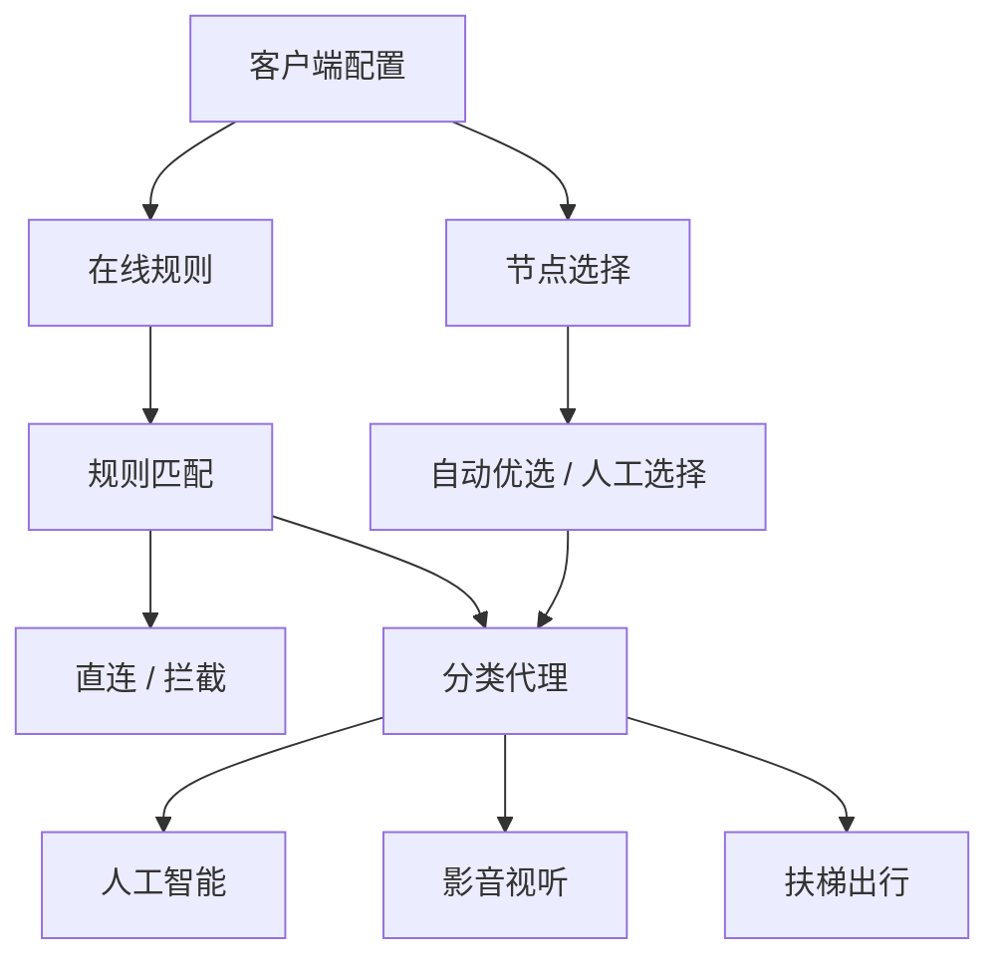

<div align="center">

# External


**Mihomo / Clash 与 Shadowrocket 智能分流配置及在线规则集**

统一桌面与移动端分流，配置统一管理节点与流量，自动选路，在线规则持续维护并定期更新。

</div>



---

## 目录

- [快速开始](#快速开始)
- [配置文件](#配置文件)
- [规则集](#规则集)
- [分流策略](#分流策略)
- [自动维护](#自动维护)
- [使用指南](#使用指南)
- [许可与声明](#许可与声明)

---

## 快速开始

### Clash / Mihomo (使用 Parser)

适用于支持 **Parser** 的客户端：Clash Verge Rev、Clash Verge、Clash Meta、Mihomo 等。

1. 打开客户端的 Parser 配置编辑页面
2. 复制 [`ParsersforClash.yml`](config/ParsersforClash.yml) 完整内容粘贴进去
3. 保存
4. 刷新原有机场订阅

> **无需修改原有订阅地址**，Parser 会在订阅更新时自动处理节点、策略组及分流配置。

### Shadowrocket (远程配置)

1. 打开 Shadowrocket「配置」
2. 点击右上角 `+`
3. 粘贴远程配置链接：
   ```
   https://raw.githubusercontent.com/akaspyrean/external/main/config/shadowrocket.conf
   ```
4. 下载并选择该配置
5. 点击「使用配置」

后续通过「更新配置」即可获取最新版。

---

## 配置文件

| 客户端 | 配置文件 | 作用 | 类型 |
|--------|----------|------|------|
| **Clash Parser** | [`config/ParsersforClash.yml`](config/ParsersforClash.yml) | 订阅预处理：过滤节点、自动测速、分类分流、在线规则 | YAML (JavaScript Parser) |
| **Shadowrocket** | [`config/shadowrocket.conf`](config/shadowrocket.conf) | 远程配置：DNS、策略组、规则集、分流 | INI 格式 |

### ParsersforClash.yml 核心能力

- ✅ 自动过滤无效节点 (流量、到期、公告等信息节点)
- ✅ 自动测速优选 (url-test，5 分钟间隔，Cloudflare 204)
- ✅ AI / 影音独立分流策略组
- ✅ 在线规则自动更新 (每日 86400s，走代理获取)
- ✅ GEO 数据自动维护 (geo-auto-update)
- ✅ 流量嗅探 (HTTP/TLS/QUIC)
- ✅ Fake-IP DNS (198.18.0.1/16)

### shadowrocket.conf 核心能力

- ✅ DNS over HTTPS (阿里/公共 DoH + 备用 8.8.8.8/1.1.1.1)
- ✅ 系统绕过 / TUN 排除路由 (私有网段、Apple/微软连通性检测)
- ✅ 自动测速组 (排除信息节点正则)
- ✅ 人工选择组 (同理排除信息节点)
- ✅ 在线规则集自动更新 (每日)
- ✅ OneDrive 特殊分流处理

---

## 规则集

规则集提供 **双格式同步输出**，由同一规则源生成：

| 类型 | YAML (Clash/Mihomo) | LIST (Shadowrocket/文本) | 规则数量 | 说明 |
|------|---------------------|--------------------------|----------|------|
| **直连** | [`rules/direct.yaml`](rules/direct.yaml) | [`rules/direct.list`](rules/direct.list) | 110,890 | 国内域名/IP、私有网段、常用服务 |
| **代理** | [`rules/proxy.yaml`](rules/proxy.yaml) | [`rules/proxy.list`](rules/proxy.list) | 27,244 | 需代理访问的域名/IP |
| **智能** | [`rules/ai.yaml`](rules/ai.yaml) | [`rules/ai.list`](rules/ai.list) | 82 | AI 服务相关域名 |
| **影音** | [`rules/media.yaml`](rules/media.yaml) | [`rules/media.list`](rules/media.list) | 1,578 | 视频/音乐/流媒体域名 |
| **广告** | [`rules/ad.yaml`](rules/ad.yaml) | [`rules/ad.list`](rules/ad.list) | 215,689 | 广告/追踪/统计域名拦截 |

**总计：355,483 条规则** (数据来源：[stats.json](stats.json)，每日自动更新)

### 格式说明

- **`.yaml`** - 供 Clash / Mihomo `rule-providers` 使用，格式为 `DOMAIN-SUFFIX,example.com` 等
- **`.list`** - 供 Shadowrocket、Surge、Quantumult X 等文本规则客户端使用，每行一条规则
- 两种格式由同一规则源生成，**保持完全同步**
- 规则集持续自动维护，**无需手动更新**

### 规则来源

- 国内直连：MetaCubeX/meta-rules-dat (geoip-cn, geosite-cn) + 手工维护
- 代理规则：社区维护列表 + 手工筛选
- AI/影音：官方域名列表 + 流行服务收集
- 广告拦截：多源聚合 (EasyList, EasyPrivacy, 反广告联盟等) + 去重

---

## 分流策略

### 规则匹配顺序

```
直连规则        → DIRECT
广告规则        → REJECT
人工智能规则    → 人工智能 (策略组)
影音规则        → 影音视听 (策略组)
代理规则        → 扶梯出行 (策略组)
未匹配流量      → 扶梯出行 (策略组)
```

### 代理策略组 (仅两个)

```
自动优选    → url-test，自动测速选择最优节点
人工选择    → select，手动选择节点
```

> **设计原则**：`DIRECT` 仅由规则层控制，**不进入代理策略组**，避免直连流量被误代理。

### 策略组在配置中的结构

**Clash Parser 生成的配置：**
```yaml
proxy-groups:
  - name: 扶梯出行
    type: select
    proxies: [自动优选, 人工选择]
  - name: 人工智能
    type: select
    proxies: [人工选择, 自动优选]
  - name: 影音视听
    type: select
    proxies: [人工选择, 自动优选]
  - name: 自动优选
    type: url-test
    url: https://cp.cloudflare.com/generate_204
    interval: 300
    tolerance: 50
    proxies: [有效节点名列表]
  - name: 人工选择
    type: select
    proxies: [有效节点名列表]
```

---

## 自动维护

### 更新机制

- **触发**：GitHub Actions 定时任务 (每日 UTC 0:00) + 手动触发
- **流程**：
  1. 从上游源拉取最新规则
  2. 去重、归一化、格式转换 (YAML ↔ LIST)
  3. 生成统计信息 (`stats.json`)
  4. 提交到 `main` 分支
- **完整性**：每次提交包含完整规则集 + 统计对比

### 版本控制

- 规则集直接维护在 `main` 分支
- 客户端通过固定原始链接获取 (如 `https://raw.githubusercontent.com/akaspyrean/external/main/rules/direct.yaml`)
- 建议客户端配置 `update-interval: 86400` (每日更新)
- 如需固定版本，可引用具体 commit SHA 的 raw 链接

### 统计信息

[`stats.json`](stats.json) 包含：
- 各规则集条数 (YAML/LIST 双格式)
- 总计数量与格式化显示
- 最后更新时间戳
- 格式一致性校验结果

---

## 使用指南

### 在 ClashEdge 中使用

ClashEdge 内置引用本仓库规则集，**无需额外配置**：

1. ClashEdge 启动时自动从 `Data/rules/` 读取本地规则文件
2. 规则更新器每日自动从本仓库拉取最新规则 (验签 + SHA256 校验)
3. 规则变更后自动热重载，无需重启核心

### 在其他 Clash 客户端中使用

#### 方式 1：Rule Providers 引用 (推荐)

```yaml
rule-providers:
  direct:
    type: http
    behavior: classical
    url: "https://raw.githubusercontent.com/akaspyrean/external/main/rules/direct.yaml"
    path: ./rules/direct.yaml
    interval: 86400
    proxy: 扶梯出行  # 通过代理获取规则
  ad:
    type: http
    url: "https://raw.githubusercontent.com/akaspyrean/external/main/rules/ad.yaml"
    path: ./rules/ad.yaml
    interval: 86400
    proxy: 扶梯出行
  # ai, media, proxy 同理...

rules:
  - RULE-SET,direct,DIRECT
  - RULE-SET,ad,REJECT
  - RULE-SET,ai,人工智能
  - RULE-SET,media,影音视听
  - RULE-SET,proxy,扶梯出行
  - GEOSITE,cn,DIRECT
  - GEOIP,CN,DIRECT,no-resolve
  - MATCH,扶梯出行
```

#### 方式 2：Parser 预处理 (零侵入)

直接使用 [`ParsersforClash.yml`](config/ParsersforClash.yml) 作为 Parser 配置，保持原有订阅不变。

### 在 Shadowrocket 中使用

直接导入远程配置：
```
https://raw.githubusercontent.com/akaspyrean/external/main/config/shadowrocket.conf
```

或手动添加规则集：
- 类型：`RULE-SET`
- URL：`https://raw.githubusercontent.com/akaspyrean/external/main/rules/ad.list`
- 策略：`REJECT`
- 更新间隔：`86400`

### 自托管镜像 (可选)

如需在内网或加速环境下使用，可 Fork 本仓库并开启 GitHub Pages，或配置反向代理：

```
# 原始链接
https://raw.githubusercontent.com/akaspyrean/external/main/rules/direct.yaml

# 自托管示例
https://your-domain.com/rules/direct.yaml
```

---

## 目录结构

```
external/
├── config/
│   ├── ParsersforClash.yml    # Clash Parser 配置
│   └── shadowrocket.conf      # Shadowrocket 远程配置
├── rules/
│   ├── direct.yaml / .list    # 直连规则
│   ├── proxy.yaml / .list     # 代理规则
│   ├── ai.yaml / .list        # AI 服务规则
│   ├── media.yaml / .list     # 影音媒体规则
│   └── ad.yaml / .list        # 广告拦截规则
├── geodata/                   # GeoIP / GeoSite / Country.mmdb (大文件，Git LFS)
│   ├── Country.mmdb
│   ├── GeoIP.dat
│   └── GeoSite.dat
├── filter.sh                  # 规则过滤/转换脚本 (内部使用)
├── stats.json                 # 规则统计信息 (自动生成)
├── mailmap.txt                # Git 提交者映射
├── LICENSE                    # MIT License
└── README.md                  # 本文件
```

---

## 许可与声明

- **许可证**：[MIT License](LICENSE)
- **用途声明**：本仓库仅用于网络配置、规则维护与技术研究
- **合规提示**：使用者应自行确认相关配置、规则及网络服务符合所在地法律法规及服务条款
- **无担保**：规则集按"现状"提供，不保证完整性、准确性或适用性

---

## 相关项目

| 项目 | 关系 | 链接 |
|------|------|------|
| **ClashEdge** | 消费者：内置规则集、Parser 配置 | [akaspyrean/clashedge](https://github.com/akaspyrean/clashedge) |
| **Mihomo** | 核心内核 | [MetaCubeX/mihomo](https://github.com/MetaCubeX/mihomo) |
| **meta-rules-dat** | Geo 数据上游 | [MetaCubeX/meta-rules-dat](https://github.com/MetaCubeX/meta-rules-dat) |

---

<div align="center">

**External** — 规则维护 · 自动更新 · 多端同步

[规则统计](stats.json) · [ClashEdge 客户端](https://github.com/akaspyrean/clashedge) · [Issue 反馈](../../issues)

</div>