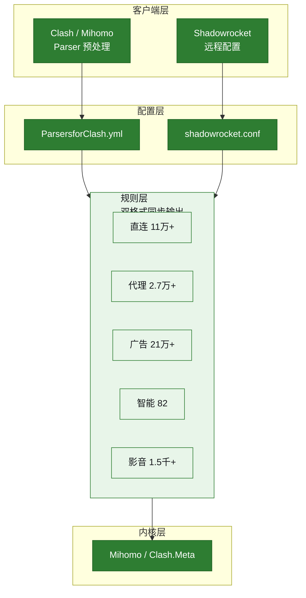

<div align="center">

# External

**Mihomo / Clash / Shadowrocket 智能分流配置与在线规则集**

统一桌面与移动端分流 · 零侵入 Parser 预处理 · 规则集每日自动更新

[](stats.json)
[](https://github.com/akaspyrean/external/actions)
[](LICENSE)
[](https://github.com/akaspyrean/clashedge)

[快速开始](#快速开始) · [配置文件](#配置文件) · [规则集](#规则集) · [分流策略](#分流策略) · [ClashEdge](https://github.com/akaspyrean/clashedge)

</div>

> 面向 **Clash Parser** 与 **Shadowrocket** 的开箱即用分流方案。导入即用，无需手写规则。

---

## 这是什么

External 提供 **两套配置文件** 与 **五套同步规则集**，覆盖直连、代理、广告拦截、AI 服务、影音流媒体五大分流场景。



| 特性 | 说明 |
| --- | --- |
| **零侵入** | Parser 模式不修改原订阅，更新订阅即自动应用分流 |
| **双格式** | YAML (Clash/Mihomo) + LIST (Shadowrocket/Surge) 同步生成 |
| **自动化** | GitHub Actions 每日构建，去重、归一化、签名校验 |
| **内置集成** | ClashEdge 启动即用，规则热重载无需重启 |

---

## 快速开始

### Clash / Mihomo (Parser 模式 · 推荐)

适用：Clash Verge Rev、Clash Verge、Clash Meta、Mihomo 等支持 Parser 的客户端。

| 步骤 | 操作 |
| --- | --- |
| 1 | 打开客户端 **Parser 配置编辑** 页面 |
| 2 | 复制 [`ParsersforClash.yml`](config/ParsersforClash.yml) 全部内容粘贴 |
| 3 | 保存 → 刷新原有机场订阅 |

> 无需改动订阅链接，Parser 在订阅更新时自动注入节点过滤、测速、分流与在线规则。

### Shadowrocket (远程配置)

1. Shadowrocket → 「配置」→ 右上角 `+`
2. 粘贴远程配置链接：
   ```
   https://raw.githubusercontent.com/akaspyrean/external/main/config/shadowrocket.conf
   ```
3. 下载 → 选择 → 「使用配置」
4. 后续点击「更新配置」获取最新版

---

## 配置文件

| 客户端 | 文件 | 类型 | 核心能力 |
| --- | --- | --- | --- |
| **Clash Parser** | [`config/ParsersforClash.yml`](config/ParsersforClash.yml) | YAML (JS Parser) | 节点过滤 · 自动测速 · AI/影音分流 · 在线规则自动更新 · Geo 数据维护 · Fake-IP DNS · 流量嗅探 |
| **Shadowrocket** | [`config/shadowrocket.conf`](config/shadowrocket.conf) | INI | DoH DNS · 系统绕过 · 自动/人工优选组 · 在线规则更新 · OneDrive 分流 |

---

## 规则集

**双格式同步输出**，同一规则源生成，保持完全一致。

| 类型 | YAML (Clash/Mihomo) | LIST (Shadowrocket/文本) | 规则数 | 说明 |
| --- | --- | --- | ---: | --- |
| **直连** | [`rules/direct.yaml`](rules/direct.yaml) | [`rules/direct.list`](rules/direct.list) | 110,890 | 国内域名/IP、私有网段、常用服务 |
| **代理** | [`rules/proxy.yaml`](rules/proxy.yaml) | [`rules/proxy.list`](rules/proxy.list) | 27,244 | 需代理访问的域名/IP |
| **智能** | [`rules/ai.yaml`](rules/ai.yaml) | [`rules/ai.list`](rules/ai.list) | 82 | AI 服务相关域名 |
| **影音** | [`rules/media.yaml`](rules/media.yaml) | [`rules/media.list`](rules/media.list) | 1,578 | 视频/音乐/流媒体域名 |
| **广告** | [`rules/ad.yaml`](rules/ad.yaml) | [`rules/ad.list`](rules/ad.list) | 215,689 | 广告/追踪/统计域名拦截 |

**总计：355,483 条规则** ([stats.json](stats.json) 每日自动更新)

### 规则来源
- **直连**：MetaCubeX/meta-rules-dat (geoip-cn, geosite-cn) + 手工维护
- **代理**：社区列表 + 手工筛选
- **AI/影音**：官方域名 + 流行服务收集
- **广告**：EasyList、EasyPrivacy、反广告联盟等多源聚合去重

---

## 分流策略

### 规则匹配顺序

```mermaid
flowchart TD
    REQ[请求进入] --> D{命中直连规则?}
    D -- 是 --> DIRECT[DIRECT 直连]
    D -- 否 --> AD{命中广告规则?}
    AD -- 是 --> REJECT[REJECT 拦截]
    AD -- 否 --> AI{命中 AI 规则?}
    AI -- 是 --> AIG[人工智能组]
    AI -- 否 --> M{命中影音规则?}
    M -- 是 --> MED[影音视听组]
    M -- 否 --> P{命中代理规则?}
    P -- 是 --> LAD[扶梯出行组]
    P -- 否 --> DEF[扶梯出行组 (兜底)]

    classDef brand fill:#2E7D32,stroke:#1B5E20,color:#FFFFFF
    classDef soft fill:#E8F5E9,stroke:#2E7D32,color:#15171B
    classDef act fill:#FFF3E0,stroke:#F57C00,color:#E65100
    class REQ,DIRECT,REJECT,AIG,MED,LAD,DEF soft
    class D,AD,AI,M,P brand
```

### 代理策略组 (仅两个核心组)

| 策略组 | 类型 | 说明 |
| --- | --- | --- |
| **自动优选** | `url-test` | 每 5 分钟测速 (Cloudflare 204)，容差 50ms，自动选最低延迟 |
| **人工优选** | `select` | 手动选择节点，排除信息/公告节点 |

> **设计原则**：`DIRECT` 仅由规则层控制，**不进入代理策略组**，避免直连流量被误代理。

### 完整策略组结构 (Parser 生成)

```yaml
proxy-groups:
  - name: 扶梯出行      # 主出口
    type: select
    proxies: [自动优选, 人工优选]
  - name: 人工智能      # AI 专用
    type: select
    proxies: [人工优选, 自动优选]
  - name: 影音视听      # 流媒体专用
    type: select
    proxies: [人工优选, 自动优选]
  - name: 自动优选
    type: url-test
    url: https://cp.cloudflare.com/generate_204
    interval: 300
    tolerance: 50
    proxies: [有效节点列表]
  - name: 人工优选
    type: select
    proxies: [有效节点列表]
```

---

## 自动维护


| 机制 | 详情 |
| --- | --- |
| **触发** | 定时 (每日 UTC 0:00) + 手动触发 |
| **完整性** | 每次提交包含完整规则集 + 统计对比 |
| **版本控制** | 直接维护在 `main`，建议客户端 `update-interval: 86400` |
| **固定版本** | 引用具体 commit SHA 的 raw 链接 |

---

## 在各客户端中使用

### ClashEdge (内置集成)

零配置：启动自动读取本地规则 → 每日自动拉取验签 → 热重载无需重启。

### 通用 Clash / Mihomo (Rule Providers)

```yaml
rule-providers:
  direct:
    type: http
    behavior: classical
    url: "https://raw.githubusercontent.com/akaspyrean/external/main/rules/direct.yaml"
    path: ./rules/direct.yaml
    interval: 86400
    proxy: 扶梯出行
  ad:
    type: http
    url: "https://raw.githubusercontent.com/akaspyrean/external/main/rules/ad.yaml"
    path: ./rules/ad.yaml
    interval: 86400
    proxy: 扶梯出行
  # ai, media, proxy 同理...

rules:
  - RULE-SET,direct,DIRECT
  - RULE-SET,ad,REJECT
  - RULE-SET,ai,人工智能
  - RULE-SET,media,影音视听
  - RULE-SET,proxy,扶梯出行
  - GEOSITE,cn,DIRECT
  - GEOIP,CN,DIRECT,no-resolve
  - MATCH,扶梯出行
```

### Shadowrocket (手动添加规则集)

- 类型：`RULE-SET`
- URL：`https://raw.githubusercontent.com/akaspyrean/external/main/rules/ad.list`
- 策略：`REJECT`
- 更新间隔：`86400`

### 自托管镜像 (可选)

Fork 本仓库开启 GitHub Pages，或配置反向代理：

```
# 原始链接
https://raw.githubusercontent.com/akaspyrean/external/main/rules/direct.yaml

# 自托管示例
https://your-domain.com/rules/direct.yaml
```

---

## 目录结构

```
external/
├── config/
│   ├── ParsersforClash.yml    # Clash Parser 配置
│   └── shadowrocket.conf      # Shadowrocket 远程配置
├── rules/
│   ├── direct.yaml / .list    # 直连规则
│   ├── proxy.yaml / .list     # 代理规则
│   ├── ai.yaml / .list        # AI 服务规则
│   ├── media.yaml / .list     # 影音媒体规则
│   └── ad.yaml / .list        # 广告拦截规则
├── geodata/                   # GeoIP / GeoSite / Country.mmdb (Git LFS)
├── filter.sh                  # 规则过滤/转换脚本 (内部)
├── stats.json                 # 规则统计 (自动生成)
├── mailmap.txt                # Git 提交者映射
├── LICENSE                    # MIT License
└── README.md
```

---

## 许可与声明

- **许可证**：[MIT](LICENSE)
- **用途**：仅用于网络配置、规则维护与技术研究
- **合规**：使用者自行确认配置、规则及网络服务符合当地法律法规
- **无担保**：按"现状"提供，不保证完整性、准确性或适用性

---

## 相关项目

| 项目 | 关系 | 链接 |
| --- | --- | --- |
| **ClashEdge** | 消费者：内置规则集与 Parser | [akaspyrean/clashedge](https://github.com/akaspyrean/clashedge) |
| **Mihomo** | 核心内核 | [MetaCubeX/mihomo](https://github.com/MetaCubeX/mihomo) |
| **meta-rules-dat** | Geo 数据上游 | [MetaCubeX/meta-rules-dat](https://github.com/MetaCubeX/meta-rules-dat) |

---

<div align="center">

**External** — 规则维护 · 自动更新 · 多端同步

[规则统计](stats.json) · [ClashEdge 客户端](https://github.com/akaspyrean/clashedge) · [Issue 反馈](../../issues)

</div>